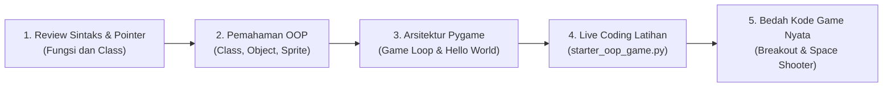

# 🎮 Modul Pembelajaran: Game Development & OOP (Pygame)
### Laboratorium Grafika, Interaksi, dan Game (Lab GIGA)

Selamat datang di modul pembelajaran **Game Development dan Object-Oriented Programming (OOP)**! 

Modul ini dirancang khusus untuk menjembatani konsep pemrograman berorientasi objek yang seringkali terasa abstrak (seperti *Class*, *Object*, *Inheritance*, dan *Encapsulation*) menjadi bentuk visual, interaktif, dan nyata melalui pembuatan game 2D berbasis **Python** dan **Pygame**.

---

## 💡 Mengapa Belajar OOP Melalui Game?

Dalam pengembangan game, paradigma berorientasi objek adalah pendekatan yang sangat natural dan intuitif:
* **Class & Object:** Anda mendefinisikan cetak biru `Enemy` sekali, lalu dapat mencetak (*instantiate*) puluhan musuh independen di layar dengan kecepatan dan posisi berbeda.
* **Encapsulation:** Menyimpan status internal karakter (seperti `hp`, `speed`, dan `score`) di dalam objek sehingga tidak tercampur dengan variabel global.
* **Inheritance:** Mewarisi fungsionalitas dari `pygame.sprite.Sprite` agar objek game langsung memiliki kemampuan kalkulasi posisi grafis dan deteksi tabrakan otomatis.

---

## 🗺️ Alur Belajar Track Game

Ikuti alur berikut secara bertahap untuk pemahaman yang optimal:



---

## 📂 Struktur Subfolder & Berkas

| Subfolder / Berkas | Deskripsi | Peruntukan |
| :--- | :--- | :--- |
| [**`OOP Di Python/`**](./OOP%20Di%20Python/) | Teori OOP dengan studi kasus game. Membahas *Sprite*, *Hitbox (Rect)*, dan *Collision Detection*. | Pembelajaran konsep & latihan live coding |
| ├── [`starter_oop_game.py`](./OOP%20Di%20Python/starter_oop_game.py) | Kerangka kode awal dengan TODO instruksi yang belum lengkap. | File kerja peserta |
| ├── [`jawaban_oop_game.py`](./OOP%20Di%20Python/jawaban_oop_game.py) | Kode solusi lengkap dengan implementasi class Enemy dan tabrakan. | Kunci jawaban & referensi |
| └── [`Fungsi dan Class/`](./OOP%20Di%20Python/Fungsi%20dan%20Class/) | Modul dasar Python: fungsi, passing argumen, pointer memori (`id`), dan dasar class. | Review dasar Python |
| [**`Pygame/`**](./Pygame/) | Panduan setup environment, arsitektur *Game Loop* (Events, Update, Render), dan contoh game. | Praktik pengembangan game |
| ├── [`requirements.txt`](./Pygame/requirements.txt) | Berkas dependensi pustaka (`pygame`). | Instalasi environment |
| ├── [`starter_hello_world.py`](./Pygame/starter_hello_world.py) | Template awal jendela game dan pergerakan kotak karakter. | Pengujian setup & game loop |
| └── [**`Games/`**](./Pygame/Games/) | Kumpulan contoh game dengan berbagai kompleksitas arsitektur. | Studi kasus kode nyata |
| [**`PPT/`**](./PPT/) | Slide presentasi materi perkuliahan/pelatihan Lab GIGA. | Materi bacaan & teori |

---

## 🚀 Panduan Hands-On & Latihan Mandiri

### Langkah 1: Pengujian Lingkungan (Setup Check)
Pastikan lingkungan virtual telah aktif dan pustaka `pygame` terpasang:
```bash
cd Game/Pygame
python -m venv env
# Aktifkan venv sesuai OS (Windows: env\Scripts\activate, Linux/Mac: source env/bin/activate)
pip install -r requirements.txt
python starter_hello_world.py
```

### Langkah 2: Menyelesaikan Latihan OOP Game
Buka file [`starter_oop_game.py`](./OOP%20Di%20Python/starter_oop_game.py):
1. **Definisikan Class `Enemy`:** Buat class yang mewarisi `pygame.sprite.Sprite`.
2. **Inisialisasi Atribut:** Berikan warna merah, ukuran, dan kecepatan jatuh acak.
3. **Logika Update:** Buat method `update()` agar musuh bergerak ke bawah dan muncul kembali dari atas layar saat keluar dari batas bawah.
4. **Deteksi Tabrakan:** Tambahkan logika `colliderect()` di dalam Game Loop untuk mendeteksi kontak antara pemain dan musuh.
5. **Verifikasi:** Jika sudah selesai atau mengalami kesulitan, bandingkan implementasi Anda dengan [`jawaban_oop_game.py`](./OOP%20Di%20Python/jawaban_oop_game.py).

### Langkah 3: Eksplorasi Studi Kasus Proyek Game
Jelajahi folder [`Pygame/Games/`](./Pygame/Games/) untuk melihat bagaimana struktur kode modular diterapkan pada game nyata:
* **[Breakout (`breakout/main.py`)](./Pygame/Games/breakout/):** Mempelajari pemisahan class paddle, bola, balok, dan pantulan sudut matematis.
* **[Advanced Space Shooter (`Advanced Space Shooter Game/core.py`)](./Pygame/Games/Advanced%20Space%20Shooter%20Game/):** Mempelajari arsitektur game lengkap dengan modul terpisah: `core.py`, `menu.py`, `highscore.py`, aset grafis (sprite sheet), dan efek audio/BGM.
* **[Avoid Falling Blocks (`Avoid_the_Falling_Blocks.py`)](./Pygame/Games/Avoid_the_Falling_Blocks.py):** Contoh game arcade sederhana berbasis skor waktu bertahan hidup.

---

## 🎯 Tantangan Mini-Project (Challenge Tasks)

Sebagai tugas akhir modul Game Development, pilih salah satu tantangan berikut:
1. **Sistem Nyawa & Game Over:** Tambahkan status HP (Health Points) pada pemain di `starter_oop_game.py`. Berikan layar game over saat HP habis.
2. **Power-Up System:** Tambahkan class `PowerUp` yang sesekali jatuh dan memberikan kecepatan ekstra atau perlindungan (*shield*) kepada pemain.
3. **Penyimpanan Skor Tertinggi (High Score):** Simpan skor tertinggi pemain ke dalam file lokal (JSON/teks) sehingga rekor tidak hilang saat game ditutup.
