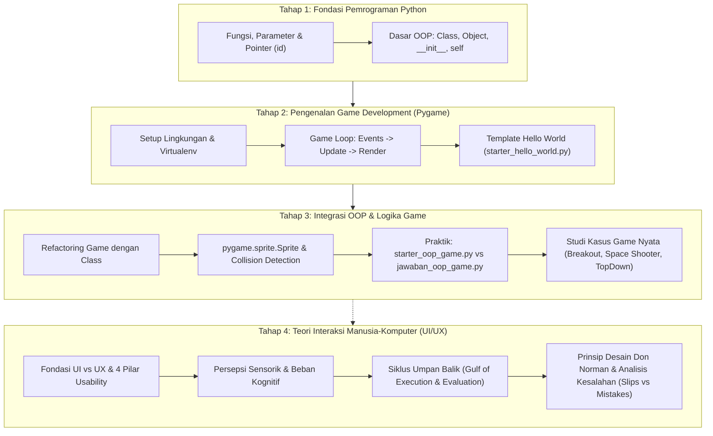

# 🚀 Modul Pembelajaran Lab Based Education (LBE) 2026
### 🎮 Laboratorium Grafika, Interaksi, dan Game (Lab GIGA)

Selamat datang di repositori resmi **Modul Pembelajaran LBE 2026**. Repositori ini disusun sebagai silabus dan materi ajar terstruktur untuk membimbing peserta memahami dua pilar utama dalam pengembangan produk interaktif modern: **Game Development (Logika & OOP dengan Python/Pygame)** dan **UI/UX Design (Human-Computer Interaction & Usability)**.

---

## 🎯 Capaian Pembelajaran (Learning Outcomes)

Setelah menyelesaikan modul ini, peserta diharapkan mampu:
1. **Pemrograman Berorientasi Objek (OOP):** Menguasai konsep dasar *Class*, *Object*, *Inheritance*, *Encapsulation*, dan pengorganisasian kode modular di Python.
2. **Game Architecture & Pygame:** Memahami arsitektur *Game Loop* (Event Handling, State Update, Rendering), manajemen FPS, manipulasi Surface, serta penanganan input.
3. **Fisika & Interaksi Game:** Menerapkan sistem *Bounding Box / Hitbox (Rect)*, deteksi tabrakan (*Collision Detection*), pemanfaatan `pygame.sprite.Sprite` & `Group`, serta state management permainan.
4. **Prinsip Human-Computer Interaction (HCI):** Menganalisis antarmuka berdasarkan 4 pilar *Usability*, batasan kognitif manusia (*Cognitive Load*), dan *Norman's 7 Stages of Action*.
5. **Desain Interaksi Don Norman:** Menerapkan konsep *Affordance*, *Signifier*, *Constraints*, *Mapping*, dan *Feedback* dalam evaluasi serta perancangan aplikasi.

---

## 🗺️ Peta Alur Belajar (Learning Path)

Berikut alur pembelajaran yang direkomendasikan untuk menyelesaikan seluruh modul:



---

## 📂 Struktur Repositori & Navigasi Modul

```text
LBE-2026/
│
├── README.md                                 # [Root] Silabus & Panduan Utama Pembelajaran
│
├── Game/                                     # Modul Jalur Game Development
│   ├── README.md                             # Pengantar & Filosofi OOP dalam Game
│   │
│   ├── OOP Di Python/                        # Materi Teori & Praktik OOP
│   │   ├── README.md                         # Panduan Konsep OOP, Analogi Game, & Collision
│   │   ├── starter_oop_game.py               # Template latihan live coding OOP
│   │   ├── jawaban_oop_game.py               # Solusi dan referensi implementasi latihan
│   │   └── Fungsi dan Class/                 # Eksplorasi sintaks dasar Python
│   │       ├── README.md                     # Rangkuman fungsi, pointer memori, dan class
│   │       ├── Class/                        # Script contoh Class, Object, __init__, __str__
│   │       ├── Function/                     # Script contoh Fungsi, Parameter, Math
│   │       └── Pointer/                      # Eksplorasi referensi objek & sys.getsizeof()
│   │
│   ├── Pygame/                               # Materi Pengembangan Game 2D
│   │   ├── README.md                         # Panduan arsitektur Game Loop & Hello World
│   │   ├── requirements.txt                  # Dependensi Python (pygame)
│   │   ├── starter_hello_world.py            # File starter interaksi dasar
│   │   └── Games/                            # Repositori Contoh & Studi Kasus Proyek Game
│   │       ├── breakout/                     # Game klasik Breakout (OOP modular)
│   │       ├── Advanced Space Shooter Game/  # Game tembak pesawat lengkap (Aset, Menu, Audio)
│   │       ├── Avoid_the_Falling_Blocks.py   # Game refleks hindari rintangan
│   │       ├── TopDown.py                    # Mekanisme pergerakan top-down 2D
│   │       ├── Clicky.py                     # Game interaksi mouse/klik
│   │       ├── Circle.py                     # Gambar primitif & geometri
│   │       ├── monopoly.py                   # Simulasi board game
│   │       └── Turtle.py                     # Eksplorasi visual dasar
│   │
│   └── PPT/                                  # Slide Presentasi Materi Perkuliahan
│       ├── Dasar Game Design - LBE GIGA.pdf  # Pengantar estetika & mekanik game
│       ├── PYGAME - LBE GIGA.pdf             # Slide teknis arsitektur Pygame
│       └── Review of OOP - LBE GIGA.pdf      # Slide penguatan konsep OOP
│
└── UI_UX/                                    # Modul Jalur UI/UX & Human-Computer Interaction
    ├── README.md                             # Diktat Lengkap 6 Modul UI/UX & Teori HCI
    ├── Dasar-Dasar-UI-UX.pptx                # Slide pengenalan konsep UI/UX
    ├── PPT Lecture 1 (Intro to HCI).pdf      # Pengantar interaksi manusia dan komputer
    ├── PPT Lecture 2.pdf                     # Persepsi manusia & pemrosesan kognitif
    ├── PPT Lecture 3.pdf                     # Model interaksi & siklus feedback
    ├── PPT Lecture 4.pdf                     # Model mental & perancangan representasi
    ├── PPT Lecture 5.pdf                     # Prinsip desain Norman (Affordance & Signifier)
    ├── PPT Lecture 7.pdf                     # Evaluasi usability & user testing
    └── PPT Lecture 8.pdf                     # Perancangan prototipe & desain antarmuka
```

---

## ⚡ Panduan Memulai (Quick Start)

### 1. Prasyarat Sistem
* **Python**: Versi `3.10` atau yang lebih baru.
* **Git**: Terinstal di sistem operasi Anda.
* **Code Editor**: Direkomendasikan menggunakan VS Code.

### 2. Instalasi & Setup Lingkungan

Kloning repositori dan siapkan *Python Virtual Environment*:

```bash
# 1. Kloning repositori
git clone https://github.com/MandyTjandra/LBE-2026.git
cd LBE-2026

# 2. Masuk ke direktori Game/Pygame
cd Game/Pygame

# 3. Buat virtual environment
python -m venv env

# 4. Aktifkan virtual environment
# Untuk Windows (Command Prompt / PowerShell):
env\Scripts\activate
# Untuk macOS / Linux:
source env/bin/activate

# 5. Pasang dependensi pustaka
pip install -r requirements.txt
```

### 3. Menguji Instalasi
Jalankan game pengujian pertama:
```bash
python starter_hello_world.py
```
*Jika jendela game terbuka dan Anda dapat menggerakkan kotak biru dengan tombol panah pada keyboard, lingkungan belajar Anda telah siap!*

---

## 📖 Silabus Rinci per Modul

### 🎮 Modul 1: Pemrograman Game & OOP (Python & Pygame)

| Sesi | Topik Utama | Berkas Acuan | Target Capaian |
| :--- | :--- | :--- | :--- |
| **01** | **Dasar Python & Memori** | [`Game/OOP Di Python/Fungsi dan Class/`](./Game/OOP%20Di%20Python/Fungsi%20dan%20Class/) | Memahami `def`, arbitrary arguments `*args`, referensi objek `id()`, dan ukuran alokasi memori. |
| **02** | **Paradigma OOP** | [`Game/OOP Di Python/README.md`](./Game/OOP%20Di%20Python/README.md) | Memahami `class`, `self`, konstruktor `__init__`, *Encapsulation*, dan *Inheritance*. |
| **03** | **Arsitektur Game Loop** | [`Game/Pygame/README.md`](./Game/Pygame/README.md) | Menguasai 3 fase Game Loop (*Event polling*, *State update*, *Surface rendering*), dan *Clock tick* (FPS). |
| **04** | **Sprite & Deteksi Tabrakan** | [`starter_oop_game.py`](./Game/OOP%20Di%20Python/starter_oop_game.py) | Mengimplementasikan `pygame.sprite.Sprite`, kalkulasi *hitbox* (`rect`), dan evaluasi `colliderect()`. |
| **05** | **Analisis Proyek Nyata** | [`Game/Pygame/Games/`](./Game/Pygame/Games/) | Membedah struktur game skala menengah: Breakout dan Advanced Space Shooter (sistem menu, audio, sprite sheet). |

---

### 🎨 Modul 2: Human-Computer Interaction (UI/UX Design)

Diktat komprehensif tersedia pada [**`UI_UX/README.md`**](./UI_UX/README.md).

| Modul | Materi | Konsep Kunci |
| :--- | :--- | :--- |
| **Modul 01** | **Fondasi UI/UX & Usability** | UI sebagai *invisible mediator*, 4 Pilar Usability (Efisiensi, Learnability, Error Tolerance, Kepuasan). |
| **Modul 02** | **Persepsi & Beban Kognitif** | Penglihatan foveal vs periferal, kontras aksesibilitas warna, batas memori kerja (4-5 chunks), *Recognition over Recall*. |
| **Modul 03** | **Siklus Umpan Balik** | Menjembatani *Gulf of Execution* & *Gulf of Evaluation*, 7 Tahapan Aksi Norman (*Goal, Plan, Specify, Perform, Perceive, Interpret, Compare*). |
| **Modul 04** | **Model Mental & Representasi** | Penyelarasan model desainer vs mental model pengguna, mitigasi *expert blind spot*, 5 prinsip *learnability*. |
| **Modul 05** | **Prinsip Fundamental Don Norman** | *Affordance* (Real vs Perceived), *Signifier*, 4 Tipe *Constraints* (Fisik, Logis, Kultural, Semantik), serta *Mapping*. |
| **Modul 06** | **Tipologi Kesalahan Pengguna** | Pembedaan mendalam antara **Mistakes** (Niat keliru / model mental salah) dan **Slips** (Keseleo eksekusi operasional). |

---

## 🛠️ Metode Pembelajaran & Penugasan

Dalam modul ini, pembelajaran dirancang menggunakan pendekatan **PBL (*Practice-Based Learning*)**:

1. **Self-Paced Study:** Pelajari ringkasan materi pada `README.md` di tiap subfolder dan slide materi di folder `PPT/`.
2. **Live Coding / Hands-on:**
   * Mulai dari file awalan `starter_oop_game.py`.
   * Lengkapi TODO yang tersedia (membuat class, menangani collision, scoring).
   * Bandingkan dan diskusikan solusi Anda dengan `jawaban_oop_game.py`.
3. **Eksplorasi Mandiri:**
   * Modifikasi parameter kecepatan, tambahkan variasi jenis musuh, atau buat fitur power-up pada game yang ada di folder `Game/Pygame/Games/`.
4. **Analisis Heuristik UI/UX:**
   * Gunakan prinsip modul UI/UX untuk menganalisis antarmuka game yang dibuat (kejelasan status skor, kontras warna, responsifitas input, pesan game over).

---

## 📋 Checklist Progres Belajar Peserta

Gunakan checklist ini untuk melacak pencapaian Anda selama program LBE:

- [ ] Memahami pembuatan dan pemanggilan fungsi serta alokasi memori di Python.
- [ ] Mampu membuat *Class*, *Object*, dan *Instance Method* secara mandiri.
- [ ] Berhasil membuat jendela Pygame dan menjalankan Game Loop stabil pada 60 FPS.
- [ ] Menyelesaikan latihan `starter_oop_game.py` dan berhasil mendeteksi tabrakan pemain vs musuh.
- [ ] Berhasil menjalankan dan memahami salah satu game studi kasus (`breakout` atau `Advanced Space Shooter Game`).
- [ ] Membaca dan memahami 6 modul prinsip UI/UX & HCI.
- [ ] Mampu membedakan *Affordance* vs *Signifier* serta *Mistakes* vs *Slips* dalam analisis studi kasus antarmuka.

---

## 🤝 Kontribusi & Etika Pembelajaran

* **Tanya & Diskusi:** Jangan ragu untuk berdiskusi dengan asisten laboratorium atau rekan sekelompok jika mengalami kendala.
* **Clean Code:** Pastikan kode yang Anda buat memiliki komentar yang jelas dan menerapkan konvensi penamaan standar Python (PEP 8).
* **Integritas:** Gunakan file `jawaban_` sebagai sarana verifikasi pemahaman, bukan sekadar jalan pintas salin-tempel.

---

<p align="center">
  <b>Laboratorium Grafika, Interaksi, dan Game (Lab GIGA)</b><br>
  <i>"Crafting Interactive Worlds through Code and Design"</i>
</p>
