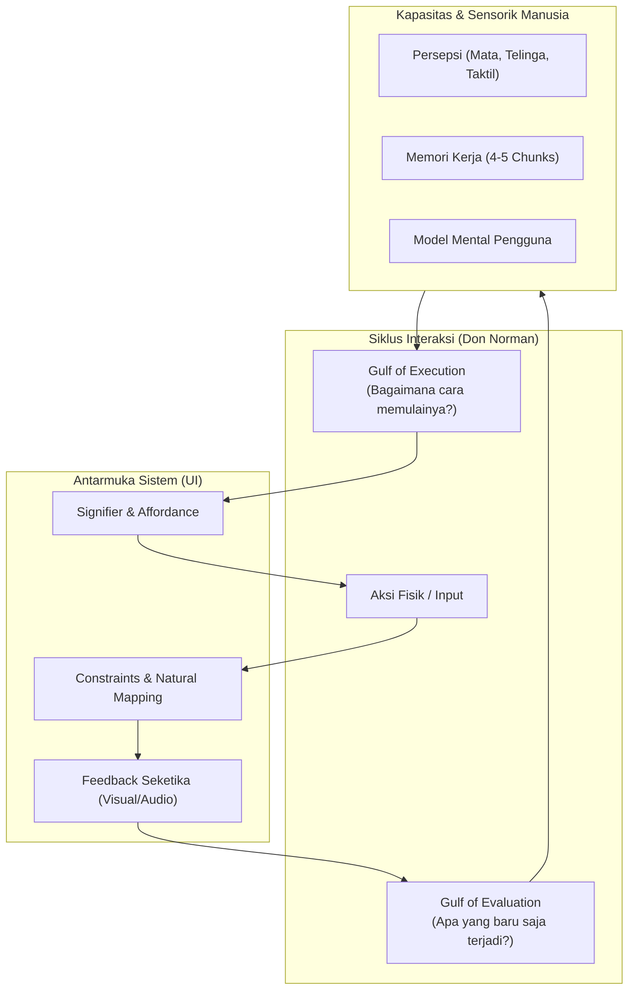
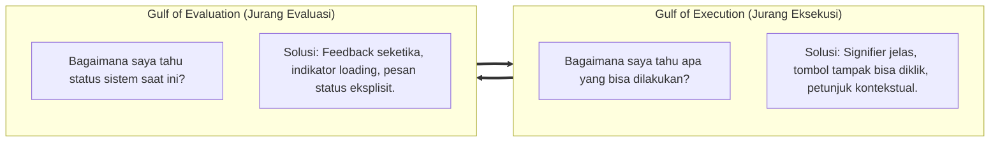

# 🎨 Modul Pembelajaran: UI/UX & Human-Computer Interaction (HCI)
### Laboratorium Grafika, Interaksi, Gim dan Analitik (Lab GIGA)

Selamat datang di modul pembelajaran **UI/UX Design dan Human-Computer Interaction (HCI)**!

Modul ini dirancang untuk membimbing peserta memahami fondasi teoretis dan metodologi praktis dalam merancang antarmuka (*User Interface*) dan pengalaman pengguna (*User Experience*) yang intuitif, ergonomis, dan berpusat pada manusia (*User-Centered Design*). Materi ini sangat relevan baik untuk perancangan aplikasi interaktif, platform web/mobile, maupun antarmuka gim (*Game UI/HUD*).

---

## 🎯 Capaian Pembelajaran (Learning Outcomes)

Setelah menuntaskan modul ini, peserta diharapkan mampu:
1. **Membedakan Domain UI & UX:** Memahami hubungan struktural antara UI visual dan UX holistik serta menerapkan 4 pilar *Usability Metrics*.
2. **Mengoptimalkan Beban Kognitif:** Merancang tata letak dan hierarki visual yang selaras dengan modalitas sensorik manusia (*central vs peripheral vision*, aksesibilitas warna, memori kerja).
3. **Menganalisis Siklus Aksi:** Mengidentifikasi dan meminimalkan celah *Gulf of Execution* dan *Gulf of Evaluation* menggunakan *Norman's 7 Stages of Action*.
4. **Membangun Model Mental yang Selaras:** Menerapkan 5 prinsip *Learnability* untuk mereduksi *Expert Blind Spot*.
5. **Menerapkan Prinsip Desain Don Norman:** Mengevaluasi dan merancang interaksi menggunakan *Affordance*, *Signifier*, *Constraints*, *Mapping*, dan *Feedback*.
6. **Mitigasi Kesalahan Pengguna (*Error Handling*):** Mengklasifikasikan galat ke dalam kategori *Mistakes* vs *Slips* serta merancang sistem yang memiliki ketahanan kesalahan (*Forgiving UI*).

---

## 🗺️ Peta Konseptual HCI & Desain Interaksi



---

## 📚 Pemetaan Modul & Slide Perkuliahan

Seluruh materi pembelajaran di bawah ini bersumber dan terhubung langsung dengan dokumen slide kuliah di direktori ini:

| Modul | Topik Bahasan | Berkas Slide Pendukung |
| :--- | :--- | :--- |
| **01** | **Fondasi UI/UX & 4 Pilar Usability** | [`Dasar-Dasar-UI-UX.pptx`](./Dasar-Dasar-UI-UX.pptx), [`PPT Lecture 1 (Intro to HCI).pdf`](./PPT%20Lecture%201%20(Intro%20to%20HCI).pdf) |
| **02** | **Persepsi Sensorik & Beban Kognitif** | [`PPT Lecture 2.pdf`](./PPT%20Lecture%202.pdf) |
| **03** | **Siklus Umpan Balik & 7 Tahapan Norman** | [`PPT Lecture 3.pdf`](./PPT%20Lecture%203.pdf) |
| **04** | **Model Mental & Prinsip Learnability** | [`PPT Lecture 4.pdf`](./PPT%20Lecture%204.pdf) |
| **05** | **Prinsip Fundamental Desain Don Norman** | [`PPT Lecture 5.pdf`](./PPT%20Lecture%205.pdf) |
| **06** | **Tipologi Kesalahan & Evaluasi Usability** | [`PPT Lecture 7.pdf`](./PPT%20Lecture%207.pdf), [`PPT Lecture 8.pdf`](./PPT%20Lecture%208.pdf) |

---

## 📖 Diktat Pembelajaran Rinci

### Modul 1: Fondasi UI, UX, dan Usability

#### 1. Definisi Inti
* **UI (User Interface):** Elemen visual, tipografi, palet warna, tombol, tata letak, dan komponen interaktif yang disentuh atau dilihat langsung oleh pengguna.
* **UX (User Experience):** Keseluruhan persepsi, kemudahan navigasi, efisiensi waktu, rasa aman, dan kepuasan emosional yang dialami pengguna saat berinteraksi dengan produk.
* **Filosofi Perantara (*Invisible Mediator*):** Antarmuka yang sempurna adalah antarmuka yang tidak disadari keberadaannya oleh pengguna—memungkinkan pengguna fokus seutuhnya pada pencapaian tujuannya (*task*), bukan bergulat dengan alatnya (*tool*).

#### 2. Empat Pilar Usability Metrics
```text
┌────────────────────────────────────────────────────────┐
│                   4 PILAR USABILITY                    │
├────────────────────┬───────────────────────────────────┤
│ 1. Efisiensi       │ Minimalisasi jumlah klik & durasi │
├────────────────────┼───────────────────────────────────┤
│ 2. Learnability    │ Seberapa cepat pengguna baru paham│
├────────────────────┼───────────────────────────────────┤
│ 3. Error Tolerance │ Toleransi galat & kemudahan undo  │
├────────────────────┼───────────────────────────────────┤
│ 4. Kepuasan        │ Kenyamanan & kepuasan subjektif   │
└────────────────────┴───────────────────────────────────┘
```

---

### Modul 2: Persepsi Sensorik & Beban Kognitif

#### 1. Modalitas Sensorik Manusia
* **Penglihatan Sentral (Foveal) vs Tepi (Peripheral):**
  * *Sentral:* Mengolah detail resolusi tinggi, ketajaman teks, dan fokus warna.
  * *Periferal:* Sangat sensitif terhadap gerakan mendadak dan kontras cahaya. Efektif untuk indikator bahaya atau animasi notifikasi darurat.
* **Aksesibilitas Warna (*Color Vision Deficiency*):**
  * Sekitar 8% pria dan 0.5% wanita mengalami keterbatasan persepsi warna (misal deuteranopia/protanopia).
  * **Aturan Emas:** Jangan pernah mengandalkan warna sebagai satu-satunya indikator status! Selalu dampingi warna dengan teks, pola, atau ikon pendukung.
* **Pendengaran & Haptik:**
  * Suara bersifat non-direksional dan tidak bisa "ditutup". Sangat baik untuk alarm, namun mudah memicu kejenuhan (*auditory fatigue*).
  * Haptik memberikan feedback privat instan pada perangkat layar sentuh dan game controller.

#### 2. Batasan Memori Kerja & Strategi Desain
* **Kapasitas Memori Kerja:** Manusia hanya mampu menampung **4 hingga 5 unit informasi (*chunks*)** aktif secara bersamaan.
* **Chunking:** Teknik memecah deretan informasi panjang ke fragmen logis (contoh: format nomor telepon `0812-3456-7890`).
* **Recognition over Recall:** Membantu pengguna *mengenali* pilihan yang terlihat di layar jauh lebih ringan secara kognitif dibandingkan memaksa pengguna *mengingat* kembali dari memori internalnya.

---

### Modul 3: Siklus Umpan Balik (Feedback Cycles)

Interaksi selalu berlangsung dalam siklus melingkar: **Aksi $\rightarrow$ Observasi Respon $\rightarrow$ Penyesuaian Niat**.



#### 7 Tahapan Aksi Norman (Norman's 7 Stages of Action)
1. **Goal:** Merumuskan tujuan ("Saya ingin menyimpan dokumen").
2. **Plan:** Menyusun rencana strategi.
3. **Specify:** Memilih perintah spesifik ("Menekan tombol Simpan").
4. **Perform:** Mengeksekusi aksi fisik pada mouse/keyboard.
5. **Perceive:** Menangkap perubahan visual pada layar.
6. **Interpret:** Memahami arti perubahan (misal: muncul ikon centang).
7. **Compare:** Membandingkan kondisi nyata sistem dengan target awal.

---

### Modul 4: Model Mental & Representasi

* **Model Mental:** Kerangka pemahaman dan ekspektasi yang dibangun oleh pengguna dalam pikirannya tentang bagaimana suatu sistem bekerja.
* **Model Desainer vs Model Pengguna:** Desainer memahami arsitektur internal teknis, sedangkan pengguna hanya melihat antarmuka luar. Kesenjangan ini harus dijembatani oleh *System Image* yang jelas.
* **Expert Blind Spot ("I Am Not My User"):** Perancang antarmuka tidak boleh mengasumsikan intuisi, kecepatan, dan pengetahuannya sama dengan pengguna akhir.

#### 5 Prinsip Kemudahan Belajar (Learnability)
1. **Predictability:** Pengguna dapat memprediksi hasil tindakan sebelum mengkliknya (contoh: tombol hapus diberi label bahaya merah).
2. **Synthesizability:** Sistem menampilkan riwayat atau status yang mengantarkan pengguna ke kondisi saat ini (contoh: breadcrumb navigasi).
3. **Familiarity:** Memanfaatkan metafora dunia nyata (contoh: ikon keranjang belanja, map folder).
4. **Generalizability:** Kebiasaan dari software lain dapat ditransfer secara intuitif (contoh: `Ctrl+Z` untuk Undo).
5. **Consistency:** Aksi yang sama selalu memicu hasil yang identik di seluruh bagian sistem.

---

### Modul 5: Prinsip Fundamental Desain Don Norman

#### 1. Affordance vs Signifier
* **Affordance:** Hubungan fisik antara objek dengan kapabilitas agen pengguna (tindakan apa yang *secara fisik dimungkinkan*).
* **Signifier:** Isyarat visual atau petunjuk eksplisit yang memberitahukan *di mana* dan *bagaimana* suatu interaksi harus dilakukan (contoh: tulisan "Tarik", border tombol yang timbul, cursor pointer).

#### 2. 4 Jenis Batasan (Constraints)
1. **Physical Constraints:** Batasan wujud fisik (contoh: steker USB tidak bisa dipasang terbalik, slider volume tidak bisa digeser melebihi batas 100%).
2. **Logical Constraints:** Batasan nalar logis (contoh: tombol *Checkout* dinonaktifkan sampai alamat pengiriman dipilih).
3. **Cultural Constraints:** Konvensi sosial global (contoh: tombol merah untuk berhenti/batal, tombol hijau untuk setuju).
4. **Semantic Constraints:** Batasan kontekstual berdasarkan makna fungsi.

#### 3. Mapping & Feedback
* **Natural Mapping:** Keselarasan spasial antara kontrol fisik dengan objek yang dikendalikan (contoh: tombol panah kiri menggerakkan karakter ke kiri).
* **Feedback:** Respon seketika dari sistem yang mengonfirmasi bahwa tindakan pengguna telah berhasil dideteksi dan diproses.

---

### Modul 6: Tipologi Kesalahan Pengguna (User Errors)

Kesalahan manusia dalam mengoperasikan sistem dibagi menjadi dua domain besar:

```text
               KLASIFIKASI KESALAHAN PENGGUNA
                             │
     ┌───────────────────────┴───────────────────────┐
     ▼                                               ▼
 MISTAKES                                          SLIPS
(Niat Keliru / Model Mental Salah)         (Keseleo Operasional / Eksekusi Keliru)
     │                                               │
     ├─ Rule-based Mistakes                          ├─ Action-based Slips
     │  (Memilih formula aturan yang salah)          │  (Salah klik tombol berdekatan)
     │                                               │
     ├─ Knowledge-based Mistakes                     └─ Memory-lapse Slips
     │  (Mendiagnosis keliru akibat minim info)         (Lupa langkah rutin, misal lupa save)
     │
     └─ Memory-lapse Mistakes
        (Lupa sebagian rencana awal)
```

#### Strategi Mitigasi Desain:
* **Mencegah Slips:** Berikan jarak aman antar tombol krusial (misal pisahkan tombol *Submit* dan *Reset*); sediakan dialog konfirmasi untuk tindakan destruktif.
* **Mencegah Mistakes:** Sediakan bantuan instruksi kontekstual (*tooltips*), pesan kesalahan yang jelas solusinya, dan fitur pembatalan (*Undo*).

---

## 🛠️ Tugas Praktik & Studi Kasus (Hands-on Assignments)

Untuk memperkuat pemahaman, peserta diwajibkan menyelesaikan 2 tugas studi kasus:

### 📝 Tugas 1: Audit Usability Game Pygame
1. Pilih salah satu game pada folder [`Game/Pygame/Games/`](../Game/Pygame/Games/) (misalnya *Breakout* atau *Advanced Space Shooter*).
2. Lakukan evaluasi heuristik antarmuka game tersebut berdasarkan:
   * **Feedforward & Feedback:** Apakah pemain tahu kapan tembakan mengenai sasaran? Apakah game over memiliki visual feedback yang jelas?
   * **Affordance & Signifier:** Apakah kontrol pemain dijelaskan secara natural di layar awal?
   * **Analisis Slips & Mistakes:** Apakah ada kemungkinan pemain salah menekan tombol yang menyebabkan kematian karakter secara tidak adil?
3. Tuliskan ringkasan evaluasi dalam 1 lembar dokumen singkat disertai rekomendasi perbaikan UI/UX.

### 🎨 Tugas 2: Perancangan Mockup HUD / UI Permainan
1. Rancanglah purwarupa sketsa (*wireframe*) antarmuka untuk game 2D (menu utama, status HUD nyawa & skor, dan layar game over).
2. Terapkan prinsip:
   * **Penglihatan Periferal:** Penempatan status vital di sudut layar yang tidak menghalangi fokus aksi utama.
   * **Aksesibilitas:** Menampilkan sisa nyawa tidak hanya dengan bar warna merah/hijau, tetapi juga dengan angka atau ikon hati.
   * **Natural Mapping:** Tata letak menu yang intuitif dinavigasi menggunakan keyboard maupun mouse.

---

## 📋 Checklist Pemahaman Materi UI/UX

Gunakan checklist ini untuk menguji pemahaman teori Anda sebelum sesi evaluasi:

- [ ] Mampu menjelaskan perbedaan mendasar antara UI dan UX dengan studi kasus nyata.
- [ ] Memahami 4 pilar *Usability Metrics* dan cara mengukurnya.
- [ ] Mampu menyebutkan batas kapasitas memori kerja manusia (*Miller's Chunking*).
- [ ] Mampu membedakan secara tegas antara konsep *Affordance* dan *Signifier*.
- [ ] Mampu menjelaskan 7 tahapan aksi Don Norman dan letak terjadinya *Gulf of Execution/Evaluation*.
- [ ] Mampu menganalisis kasus insiden antarmuka dan mengategorikannya apakah tergolong *Slip* atau *Mistake*.
- [ ] Telah membaca dan mengkaji slide kuliah pada direktori ini (`Lecture 1` hingga `Lecture 8`).

---

<p align="center">
  <b>Laboratorium Grafika, Interaksi, Gim dan Analitik (Lab GIGA)</b><br>
  <i>"Designing Intuitive Human Experiences through Science and Empathy"</i>
</p>
